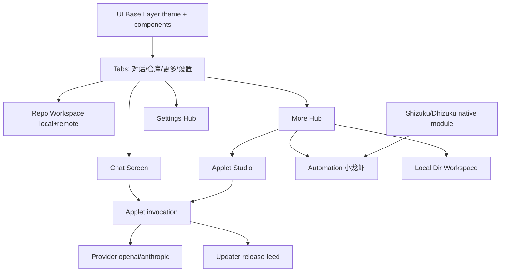

# PocketDev 1.0.3 技术设计

Feature Name: pocketdev-v1-0-3
Updated: 2026-10-31

## Description

1.0.3 批次覆盖：更新体验增强（进度条/安装输出/更新动画/更新公告）、交互流（流动式输出、计划模式、待发送队列、停止对话）、引导/服务商（拉取模型）、更多功能入口、本地目录工作区、功能应用（Applet）开发与 AI 调用、UI 底层重建与 Android 8–17 适配。Shizuku/Dhizuku 手机自动化以原生模块骨架交付 + 真机接入指引。

## Architecture

UI 分层：`src/ui/`（新 UI 基础层）→ `app/**`（页面壳）→ `src/components/**`（业务组件）。逻辑层集中在 `src/api/`（ai / updates / models / git / applets）与 `src/store/`（状态）。

## Components and Interfaces

- `src/ui/tokens.ts`：间距、圆角、字号、动效时长、层级令牌。
- `src/ui/theme.tsx`：浅色/深色调色板与 `useTheme()`。
- `src/ui/components.tsx`：`Screen`、`Surface`、`Button`、`Field`、`Pill`、`Sheet`、`ProgressBar`、`Segmented`、`ListRow`、`AnimatedBackdrop`。
- `app/(tabs)/_layout.tsx`：新增「更多」tab（位于仓库与设置之间）。
- `app/more.tsx`（或 `app/(tabs)/more.tsx`）：更多功能入口。
- `app/applets/index.tsx`：功能应用列表；`app/applets/[id].tsx`：编辑器 + 运行。
- `src/api/applets.ts`：Applet 定义持久化、注册表、调用执行。
- `src/api/updates.ts`：修复 tag/asset 解析；新增下载进度与安装输出；新增更新公告读取。
- `src/store/app.tsx`：扩展 prefs（计划模式、自动更新、Applet 可用集合、工作区类型）。

## Data Models

- `AppletDef`：`{ id, name, description, code, enabled, params: [{key,label,type}], createdAt }`
- `ReleaseInfo`：扩展 `notes: string`（更新公告正文预留，取自 Release 描述）。
- `Prefs`：新增 `planMode: boolean`、`appletEnabled: Record<string, boolean>`、`localWorkspace: string | null`。
- `Workspace`：`{ kind: 'git' | 'local', name, root, repoFullName? }`

## Correctness Properties

- 更新检测：最新 tag 解析必须匹配语义化版本；下载地址必须可达；失败可恢复。
- 队列发送：第一条结束才发送第二条；「立即发送」丢弃等待即发；「停止对话」清空队列并中止当前生成。
- Applet：仅在已启用集合内可调用；调用参数缺失时返回结构化错误。
- UI：主题切换后所有令牌一致生效；无硬编码颜色泄漏。

## Error Handling

- 更新下载失败：显示错误 + 重试 + 跳转发布页。
- Applet 运行错误：捕获并展示堆栈前两行，不影响会话。
- 本地目录权限被拒：提示重新选择。
- Shizuku/Dhizuku 不可用：显示权限不可用及开启指引。

## Test Strategy

- `npx tsc --noEmit` 作为静态门禁。
- Gradle `assembleRelease` 验证 JS bundle 与原生合并。
- 手工用例清单：更新进度、动画、公告、计划模式、队列发送、停止、Applet 调用、本地工作区、主题切换。
- Shizuku/Dhizuku：仅编译验证，真机用例另列。

## References

- `src/api/updates.ts`
- `app/(tabs)/index.tsx`
- `app/(tabs)/_layout.tsx`
- `src/components/ui.tsx`
- `src/store/app.tsx`
