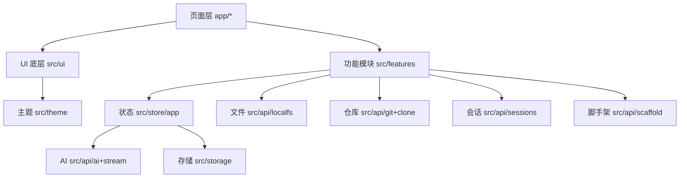

# Design Document — PocketDev v1.0.6

Feature Name: pocketdev-v1-0-6
Updated: 2026-11-01

## Description

大版本重构：主页消息气泡/排版修复 + 文案精简 + `src/ui` 底层全量重写（含 AI 状态反馈）+ 协议重写 + 删除功能应用 + Android 项目脚手架 + 文件管理 + 消息搜索/会话历史 + 主题切换补全 + 工作区选择器重构（移输入栏上方、联动文件）+ 仓库独立并自动拉取源码 + 核心底层优化。

## 现状基线

- **UI 底层**：`src/ui/tokens.ts`（space/radius/type/motion/elevation/layout）+ `src/ui/base.tsx`（AuroraLayer/GlassPane/ProgressBar/Segmented/BottomSheet/ListRow/UpdateTransition/CodeBlock/TogglePair/Collapsible）+ `src/ui/index.ts`（Button/Pill/Surface/Row/Screen/EmptyState/Field/IconButton/SectionLabel/Spacer/SubScreen）。
- **主题**：`src/theme/index.tsx` 已支持 `ThemeMode = light|dark|system` + 10 套 ACCENTS（Aries-AI 色板）+ useColorScheme 跟随系统。
- **状态层**：`src/store/app.tsx`（provider/git/workspaces/activeWorkspaceId/prefs/localModels/tabBarVisible）。
- **主页**：`app/(tabs)/index.tsx` 1004 行，内联大量样式与 @CALL 解析。
- **本地 FS**：`src/api/localfs.ts`（inspectDir/listDir/readTextFile/writeTextFile），缺 mkdir/rename/remove。
- **Git**：`src/api/git.ts` REST API（GitHub/GitLab/Gitee/Gitea），无源码拉取。
- **协议**：`src/agreements.ts`（AGPL/引用/须知/隐私 + REFERENCES）。
- **消息**：`useState` 未持久化，无会话/搜索。

## Architecture



## 组件与接口（UI 底层新增/重构）

| 组件 | 职责 |
|---|---|
| `TypingDots` | AI 思考打字动画（输入栏上方） |
| `ToolStatusBar` | 「正在使用 XX 工具」进度/完成/失败状态 |
| `ChatBubble` | 气泡统一宽度约束 + 代码块横向滚动 + 流式平滑追加 |
| `Composer` | 输入栏 + 上方 WorkspaceSwitcher + 状态反馈区 |
| `WorkspaceSwitcher` | 输入栏上方可展开选择器，本地目录/仓库切换 |
| `FileManager` | 目录浏览 + 新建/重命名/删除 |
| `SessionPicker` | 历史会话列表 + 消息搜索 |
| `ScaffoldSheet` | Android 项目脚手架生成入口 |

## 功能模块（src/features/）

- `chat/`：`useChatEngine`（流式/工具/竞态控制）、`MessagesList`、`Composer`
- `files/`：`FileManager`
- `repo/`：`RepoList`（独立入口）、`CloneProgress`（自动拉取源码）
- `sessions/`：`SessionPicker`、`searchMessages`
- `scaffold/`：`ScaffoldSheet`、`generateAndroidScaffold`

## Data Models

```ts
type ThemeMode = 'light' | 'dark' | 'system';
interface Session { id: string; title: string; updatedAt: number; messages: Bubble[] }
interface Workspace {
  id: string; name: string;
  kind: 'local' | 'repo';
  root?: string;               // 本地目录（含拉取的仓库代码）
  repoFullName?: string; branch?: string; repoUrl?: string;
}
type ChatStatus =
  | { kind: 'idle' }
  | { kind: 'thinking' }
  | { kind: 'tool'; name: string; phase: 'running' | 'done' | 'error' };
```

## 仓库自动拉取源码（R12 关键）

RN 环境无 git CLI。方案：REST API 递归拉取（GitHub `git/trees?recursive=1` + `git/blobs`，其他平台对应接口）写入 `expo-file-system` 本地目录。

- 限制：单文件 ≤ 5MB，总数 ≤ 2000 文件，跳过二进制/`node_modules`/`.git`/`build`/`dist`。
- 进度回调：`{ done, total, currentFile }`，支持取消。
- 拉取后本地目录成为 `Workspace.root`，与文件管理联动。

## Correctness Properties

1. 删除功能应用后，`grep -rn "applets" src app` 无残留；`npm run ci` 通过。
2. 主题切换：单一 `theme` context，mode 变化即重算 palette，全局一致。
3. 流式追加：`useChatEngine` 用 ref 合并，气泡 DOM 追加不触发全列表重排跳动。
4. 工作区切换与发送并发：请求绑定发起时工作区快照，切换不串扰。
5. 路径安全：文件操作路径规范化，拒绝越界（如 `..` 越出工作区）。

## Error Handling

- 文件操作失败 → 明确错误 + 不崩溃。
- 拉取源码：网络/token 失败显示原因，支持重试；超限文件跳过并提示。
- 脚手架：写入失败回滚（删除已建文件）并提示。
- 会话搜索：无结果空态，切换失败回退当前会话。

## Test Strategy

- 纯逻辑单测（`src/**/__tests__/`）：
  - `sessions`：会话增删、消息搜索命中
  - `scaffold`：脚手架文件清单与内容（Gradle/Manifest）
  - `localfs`：路径安全规范化
  - `clone`：树解析/文件过滤/大小限制
  - `agreements`：引用/协议字段完整
- 删除验证：无 `applets` 残留。
- UI 以 CI Build & Test 为准（不写 UI 快照测试）。

## 阶段拆分（实施顺序）

1. 删除功能应用 + 协议重写 + 文案精简（低风险，先落地）
2. 核心底层：存储/会话/搜索 + localfs 扩展 + 路径安全
3. UI 底层：ChatBubble/Composer/TypingDots/ToolStatusBar + 主页拆分修复
4. 工作区选择器重构 + 文件管理
5. 仓库独立 + 源码拉取
6. Android 脚手架
7. 主题切换补全 + 全量迁移
8. 版本 1.0.6 + 全量 ci + 发版

## References

[^1]: 需求 - `.monkeycode/specs/pocketdev-v1-0-6/requirements.md`
[^2]: 主页 - `app/(tabs)/index.tsx`
[^3]: 底层 - `src/ui/tokens.ts`、`src/ui/base.tsx`、`src/ui/index.ts`
[^4]: 主题 - `src/theme/index.tsx`
[^5]: 仓库 - `src/api/git.ts`、`app/(tabs)/repo.tsx`